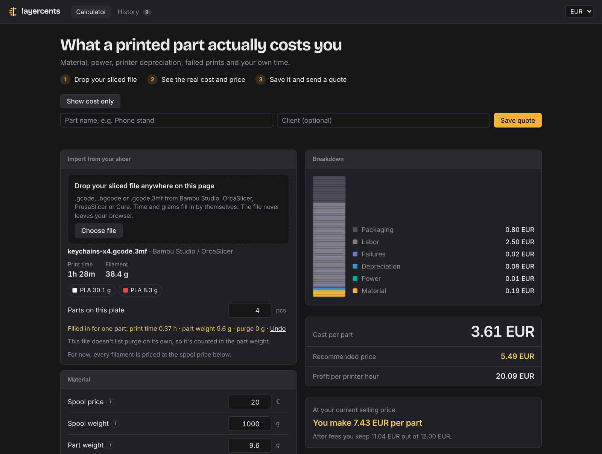
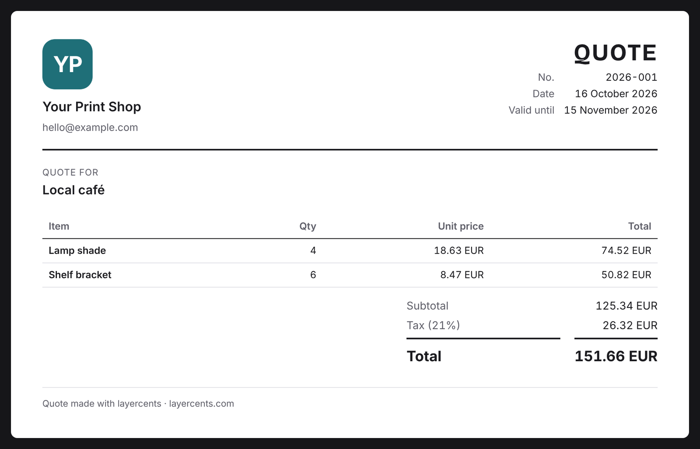
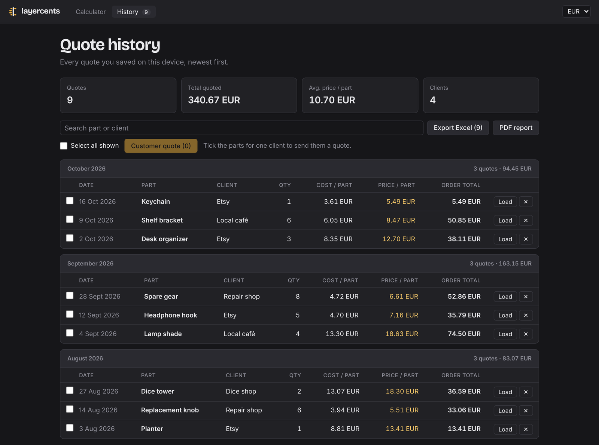

<p align="center">
  
</p>

<h1 align="center">layercents</h1>

<p align="center">
  <strong>Layer by layer, cent by cent.</strong><br>
  A free 3D print cost calculator. Drop the file from your slicer and get the real cost of each part, the price to charge and a quote for your customer.
</p>

<p align="center">
  <a href="https://layercents.com"><strong>Open layercents.com</strong></a>
</p>



## What it does

- **Reads your slicer file.** Drop a `.gcode`, `.bgcode` or `.gcode.3mf` from Bambu Studio, OrcaSlicer, PrusaSlicer or Cura and the print time, grams and purge fill in by themselves. Several parts on one plate, or several plates, are fine.
- **The whole cost, not just filament.** Material and purge, electricity, printer wear, failed prints, your time, packaging and platform fees, per part, with a layered chart.
- **A price that pays you.** The recommended selling price for your target margin, and what you really keep at the price you charge now.
- **History.** Save each quote with the part and the customer. Search them, see monthly totals and load any of them back into the calculator.
- **Excel and PDF.** Export every quote to a formatted `.xlsx` file, or print a PDF report with charts.
- **Customer quotes.** Tick the parts for one customer and get a quote with your logo, shipping, tax and notes, ready to save as a PDF. Your costs and margins never appear on it.
- **Your currency**, with live exchange rates. It works on a phone too.

## A quote for your customer



## Every quote you saved



## Private by design

There is no account and no server. Your files are read inside your browser and your quotes are kept in your browser's storage, so nothing you type or drop is uploaded anywhere.

The flip side: clearing your browser data deletes your quotes, so export them to Excel now and then.

## What's next

- Several filaments per part, each with its own price
- Saved printer and material profiles
- How many parts a week your printer can make

Ideas and bug reports are welcome: [open an issue](../../issues). If a slicer file doesn't import, zip it and attach it to the issue: that helps a lot.

## Run it locally

You need Node.js 20.19 or newer. Clone the repository, then:

```bash
npm install
npm run dev
```

Built with React and Vite. The live site is hosted on GitHub Pages.

## License

The code is public so you can see how it works, but it isn't open source: all rights reserved. The calculator itself is free to use at [layercents.com](https://layercents.com).
